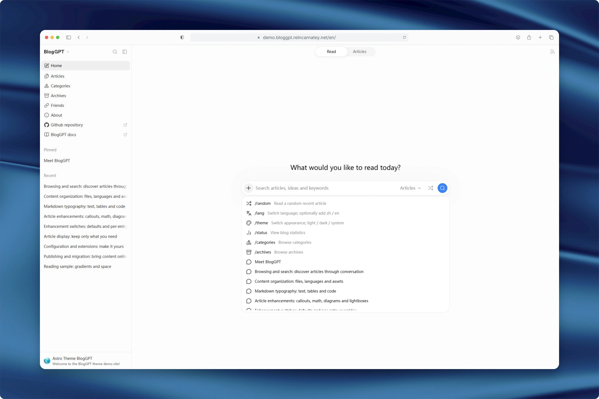
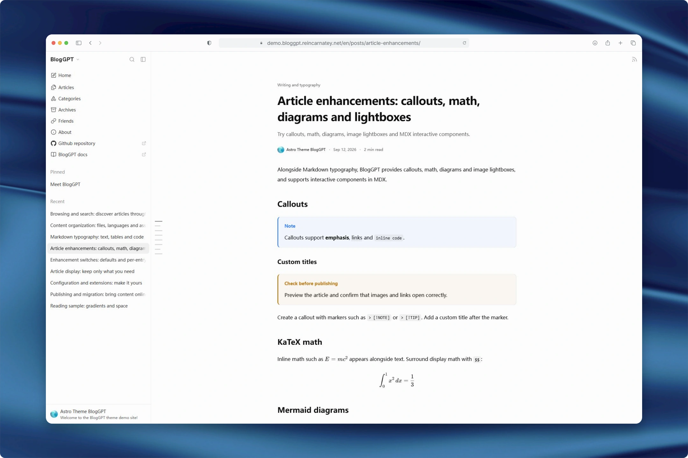
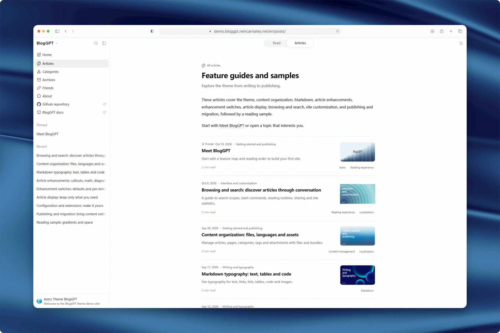
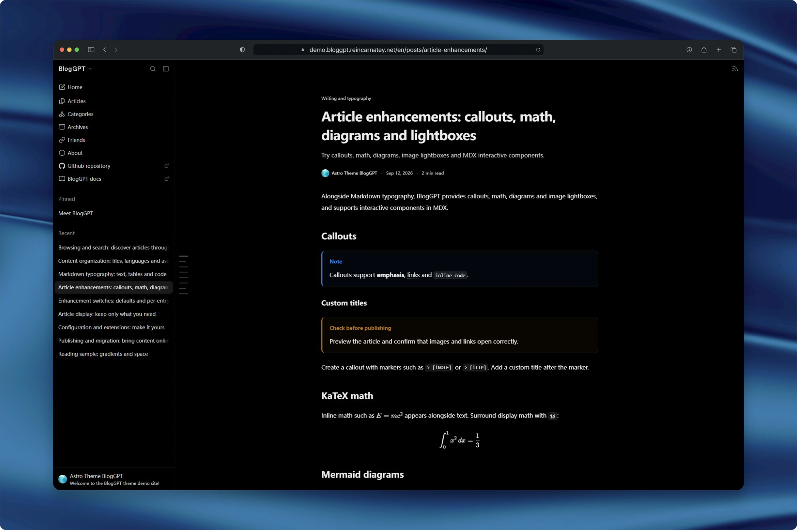
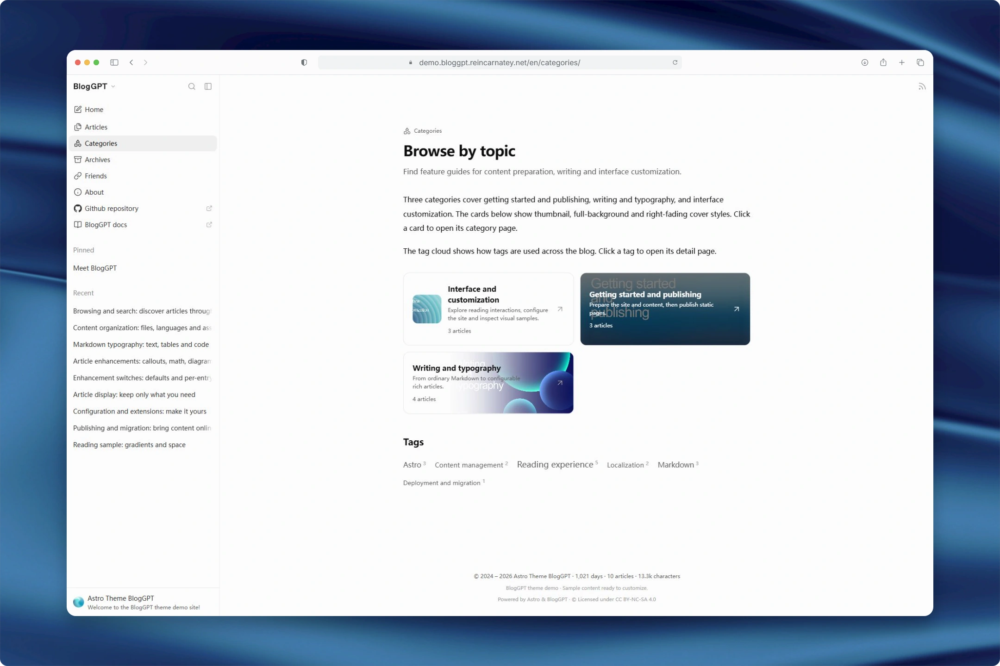
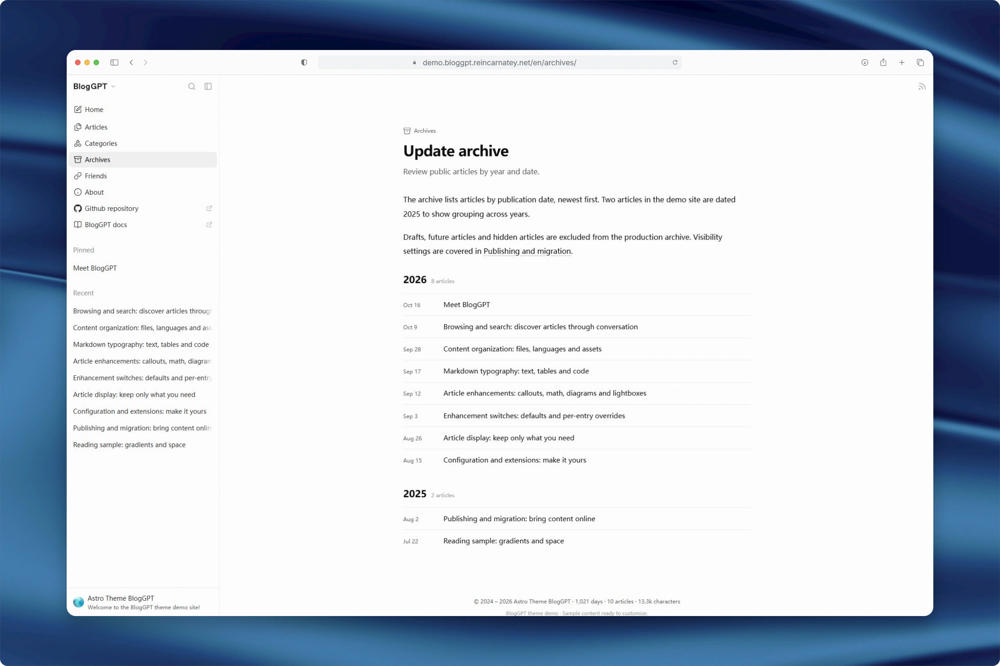
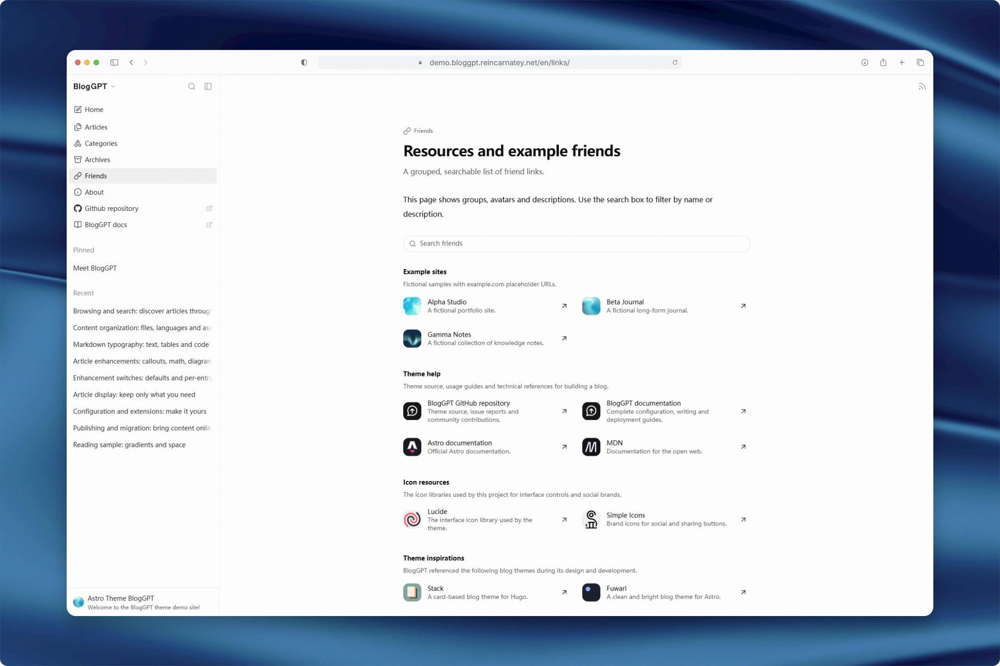
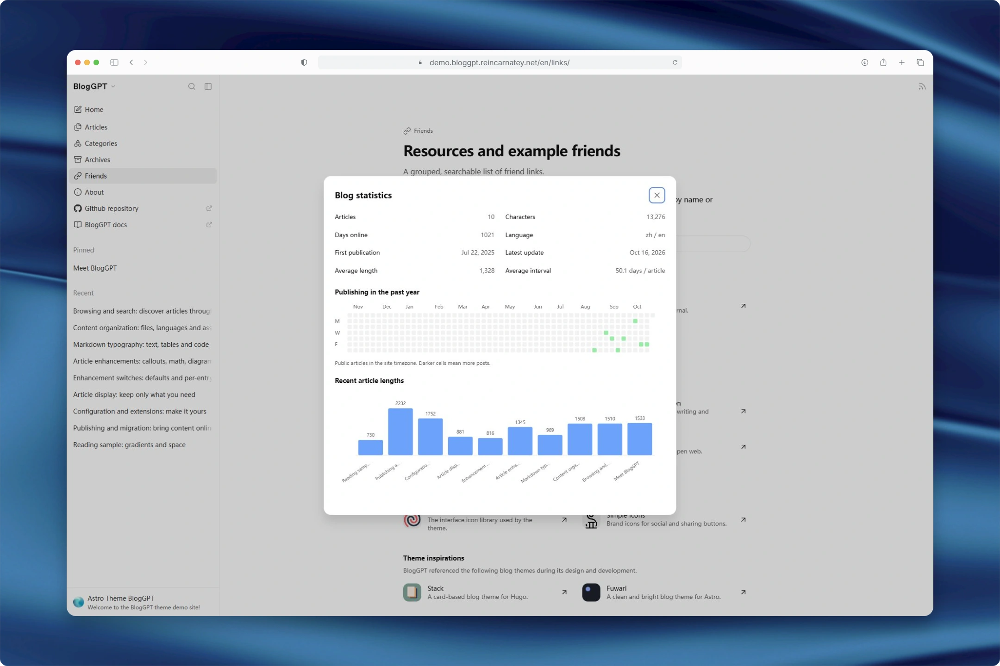

# BlogGPT

**一个用 Astro 构建，受到 ChatGPT 布局启发的博客主题。**

使用 Markdown 或 MDX 写作，以文件管理内容。通过熟悉的侧栏、专注的阅读区域和搜索框，让读者找到下一篇想读的文章。

[English](README.md) · **简体中文**

[查看演示](https://demo.bloggpt.reincarnatey.net) · [使用文档](https://bloggpt.reincarnatey.net/)

[](https://vercel.com/new/clone?repository-url=https%3A%2F%2Fgithub.com%2FRaincarnator%2Fastro-theme-BlogGPT-starter)
[](https://app.netlify.com/start/deploy?repository=https://github.com/Raincarnator/astro-theme-BlogGPT-starter)

通过[精简 starter](https://github.com/Raincarnator/astro-theme-BlogGPT-starter) 创建个人博客，初始仅有一篇欢迎文章、一个关于页和指向官方文档站的友链。点击按钮，在平台中创建自己的 Git 仓库，并使用随附配置完成部署；之后向自己的仓库推送修改即可更新站点。详见[一键部署说明](https://bloggpt.reincarnatey.net/guide/deployment#一键部署-starter)。

> **开始搭建博客：** 先阅读[安装与预览](https://bloggpt.reincarnatey.net/guide/getting-started)，再通过[使用文档](https://bloggpt.reincarnatey.net/)了解配置、写作与部署。



## 功能

| 分类       | 功能                                                                                                  |
| ---------- | ----------------------------------------------------------------------------------------------------- |
| 阅读界面   | 响应式布局、可调整侧栏、浅色/深色/跟随系统外观、章节预览与可展开目录、快捷键和客户端导航              |
| 内容管理   | 文章、独立页面、分类与标签；嵌套目录、稳定 slug、附件内容包与写作模板                                 |
| 正文增强   | Markdown / MDX、Expressive Code、KaTeX、Mermaid、Callouts、PhotoSwipe 与交互组件                      |
| 内容浏览   | 置顶与时间线列表、文章分页与页码跳转、分类封面、标签词云、年份归档和分组友链                          |
| 站内搜索   | 文章、标题与简介、正文、全站四种范围；上下文高亮、斜杠命令与文章标题补全                              |
| 国际化     | 界面文案与内容均支持配置国际化；内置中文与英语（AI 翻译）                                             |
| 分享与订阅 | 格式化复制、可配置社交平台、Satori 分享封面、RSS 与 Sitemap                                           |
| 博客统计   | 文章与字数的总量和均值、发布间隔、首次发布与最近更新、发文热力图及文章字数柱状图                      |
| 站点定制   | 丰富的配置项覆盖外观、内容和交互，配合全站 HTML / CSS / JS 扩展文件，让站点可以按自己的喜好灵活定制。 |

BlogGPT 生成静态文件，可直接发布到静态托管服务。

## 界面预览

### 文章页面 · 浅色



<details>
<summary>展开查看其余六张界面预览</summary>

### 文章列表



### 文章页面 · 深色



### 分类



### 归档



### 友链



### 统计



</details>

截图使用 **1920 × 1200** 尺寸拍摄，通过 [RicoScreenshot](https://shot.ricoui.com/) 美化。

## 快速开始

搭建个人博客可使用上方 starter 或部署按钮。本主题仓库保留完整演示内容与文档 workspace；维护者可阅读 [starter 自动发布流程](starter/MAINTAINING.md)。

环境要求：**Node.js 22.12+** 和 **pnpm 11**。下载或克隆仓库，进入根目录后运行：

```sh
pnpm install
pnpm dev
```

打开终端显示的地址。博客与文档由 pnpm workspace 统一管理，安装一次依赖即可。

### 改成自己的站点

1. 编辑 `blog.config.ts`，设置完整生产地址 site.baseUrl（含部署子目录）、语言、作者、说明文字与导航。
2. 在 `friends.config.ts` 替换分组友链，或导出空数组 `[]`。
3. 重写关于页面，替换 content 下的文章、分类和标签。
4. 发布前替换示例头像、社交链接和 example.com 占位地址。

通过 `site.locales` 和 `site.defaultLocale` 设置启用语言与默认语言。

日常配置、写作和定制主要在 `blog.config.ts`、`content/`、`public/`、`custom/` 与 `archetypes/` 中完成，友链单独使用 `friends.config.ts`。一次性 MDX 组件放在文章内容包内，复用组件放在 `custom/components/`。

### 写一篇文章

```sh
pnpm new post hello --title "My first article"
pnpm new post hello-bundle --use bundle --title "An article with attachments"
```

第一个命令生成单文件，第二个生成包含 `index.mdx` 的内容包，可在同目录添加图片和附件。类型用单数 post、page、category、tag。--use 选择模板，--title 设置标题；省略标题时使用 slug 的最后一段。

默认文章模板生成**草稿**。完成后改为 `draft: false`，并设置发布时间。

### 构建和部署

```sh
pnpm build
pnpm preview
```

推荐将 Git 仓库连接到 **Vercel**，选择 Astro，构建命令使用 `pnpm build`，产物目录填写 `dist`。生产分支的提交会自动构建并发布，完整步骤见 [Vercel 部署教程](https://bloggpt.reincarnatey.net/guide/deployment#vercel-部署-推荐)。其他静态托管服务也可以发布完整 `dist/`。

构建会检查类型、生成页面、复制附件、生成可选分享图并创建搜索索引。`preview` 读取生产产物，修改后需要重新构建；预约文章到达发布时间后也需要再次构建。

界面翻译及注册配置集中在 `src/i18n/`。站点通过 `site.locales` 选择内容语言，缺少对应界面译文时自动回退；社区翻译者添加翻译文件并在 `src/i18n/i18n.config.ts` 注册后，一同贡献到仓库。详见[语言与翻译](https://bloggpt.reincarnatey.net/content/languages)。

## 使用文档

阅读[简体中文文档](https://bloggpt.reincarnatey.net/)或 [English documentation](https://bloggpt.reincarnatey.net/en/)。文档完整介绍安装、配置字段、内容管理和部署方式。

| 指南                                                                  | 内容                                               |
| --------------------------------------------------------------------- | -------------------------------------------------- |
| [安装与预览](https://bloggpt.reincarnatey.net/guide/getting-started)  | 安装、首次修改和常用命令                           |
| [完整配置参考](https://bloggpt.reincarnatey.net/config/reference)     | 全部公开字段的类型、必填性、初始值、缺省行为和效果 |
| [Frontmatter](https://bloggpt.reincarnatey.net/content/frontmatter)   | 日期、封面、可见性、分类标签和逐篇开关             |
| [内容组织](https://bloggpt.reincarnatey.net/content/organization)     | 内容集合、稳定网址与嵌套文件夹                     |
| [多语言](https://bloggpt.reincarnatey.net/content/languages)          | 界面文字与正文翻译文件                             |
| [Archetype 模板](https://bloggpt.reincarnatey.net/content/archetypes) | 新建命令、模板和占位符                             |
| [扩展文件](https://bloggpt.reincarnatey.net/customization/hooks)      | 全站 HTML、CSS 和客户端生命周期                    |
| [部署](https://bloggpt.reincarnatey.net/guide/deployment)             | 域名、子目录与构建产物                             |

## 项目结构

```text
blog.config.ts       主题设置与多语言文案
friends.config.ts    分组友链
src/i18n/            界面翻译与注册配置
content/posts/       文章
content/pages/       独立页面与内置列表介绍
content/categories/  分类名称、封面和介绍
content/tags/        标签名称、封面和介绍
archetypes/          默认与命名模板
custom/              全站 HTML / CSS / JS 扩展
custom/components/   可复用的 MDX 组件
public/              共享公开资源
src/                 主题实现
apps/docs/           使用文档
```

分类标签使用内容文件定义，index.md / index.mdx 内容包会将目录内附件发布到页面旁边。使用显式 slug 可以保持网址稳定；可用 `posts.pathPrefix` 在 slug 前加入 `[year]` 等发布日期片段。

## 开发与验证

```sh
pnpm check
pnpm lint
pnpm format:check
pnpm build
pnpm test
pnpm docs:build
```

涉及构建产物的测试应在 build 后执行。pnpm build:all 一起构建博客与文档。

提交 PR、贡献翻译与 CI 校验流程见[贡献指南](CONTRIBUTING.md)。

## 致谢与许可

布局受到 ChatGPT 启发，UI 图标使用 Lucide，社交品牌图标使用 Simple Icons。演示渐变图通过 [FeralUI Gradient Builder](https://feralui.dev/gradients) 创建，具体用途见[演示素材](https://bloggpt.reincarnatey.net/guide/overview#演示站点)。

主题代码采用 [Apache-2.0](LICENSE)，文档采用 [MIT](apps/docs/LICENSE)，博客内容许可通过页脚设置。字体、图标与图片来源见[第三方资源声明](THIRD_PARTY_NOTICES.md)。
