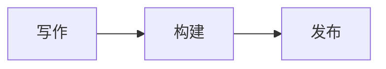

# 文章增强

`article` 设置正文增强的全局默认值，单篇通过 frontmatter 的同名字段覆盖。

```ts
article: {
  math: true,
  mermaid: true,
  lightbox: true,
  callouts: true,
  toc: { enabled: true, minDepth: 2, maxDepth: 4, expandDelay: 1000 },
  shareCover: {
    enabled: true, width: 1200, height: 630,
    background: '#f5f5f5', foreground: '#171717', accent: '#3b82f6',
  },
}
```

## KaTeX 公式

行内公式写作 `$E=mc^2$`，独立公式用两行 `$$` 包围：

```md
$$
\int_0^1 x^2\,dx = \frac{1}{3}
$$
```

公式在构建时由 KaTeX 渲染。`math: false` 将其保留为 TeX 源码。

## Mermaid 图表

使用语言为 `mermaid` 的代码块：

````md

````

图表接近可视区域时加载渲染器，配色随外观切换。读者可以展开查看源代码。`mermaid: false` 将内容显示为代码块。

## PhotoSwipe 图片灯箱

点击正文图片可放大查看，支持缩放、多图切换和键盘操作。灯箱资源在首次打开时加载。已有链接的图片使用其链接；单张图片可通过 `data-no-lightbox` 排除。

## Callouts 提示块

```md
> [!NOTE]
> 这里是一段提示。

> [!WARNING] 自定义标题
> 发布前检查图片和链接。
```

支持 NOTE、TIP、IMPORTANT、WARNING、CAUTION，以及 INFO、SUCCESS、QUESTION、DANGER。提示块内可继续写 Markdown，也可以嵌套引用。

## MDX 交互组件

### 文章内的一次性组件

一次性组件与正文放在同一个内容包内，相关脚本、样式和组件文案也放在这里。演示文章的目录如下：

```text
content/posts/demos/article-enhancements/
  index.zh.mdx
  index.en.mdx
  SineWave.astro
  sine-wave.ts
  gallery-a.webp
  gallery-b.webp
```

在同目录的 MDX 中导入：

```mdx
import SineWave from './SineWave.astro';

<SineWave lang="zh" />
```

组件支持振幅、周期和初始相位滑块、方向键与重置。`lang` 省略时使用站点默认语言；示例自带中文与英文文案，其他语言使用英文。添加组件自己的译文时，编辑 `SineWave.astro` 中的 `labels`。

简单的一次性结构也可以直接写在 MDX 中：

```mdx
<aside class="not-prose">
  <strong>实验说明</strong>
  <p>拖动上方滑块，观察函数曲线的变化。</p>
</aside>
```

需要 Astro 的 `<script>`、`<style>` 或更复杂的交互时，将源码放在包内的 `.astro` 文件中，再从 MDX 导入。内容包中的组件源码与其他附件一样随文章公开。

### 多篇文章复用的组件

复用组件放在 `custom/components/`。例如，创建 `custom/components/InfoBox.astro`：

```astro
---
interface Props {
  title: string;
}
const { title } = Astro.props;
---

<aside class="info-box not-prose">
  <strong>{title}</strong>
  <slot />
</aside>

<style>
  .info-box {
    padding: 1rem;
    border: 1px solid var(--border);
    border-radius: 12px;
  }
</style>
```

在 `content/posts/example/index.mdx` 中使用：

```mdx
import InfoBox from '../../../custom/components/InfoBox.astro';

<InfoBox title="延伸阅读">
  <p>这里可以放补充说明。</p>
</InfoBox>
```

导入路径相对于当前 MDX 文件。由文章传入标题等文案，或将组件专用的多语言字典放在 `custom/components/`。组件引用后由 Astro 编译，脚本和样式也随组件处理。

### 客户端交互

原生 Astro 组件通过自身的 `<script>` 提供交互，无需额外框架集成。使用自定义元素时，在 `connectedCallback` 中绑定交互，在 `disconnectedCallback` 中清理监听器，确保站内切页后仍可正常使用。正弦函数示例展示了这种方式。

需要 React、Vue 或 Svelte 时，添加对应 Astro 集成，再为框架组件设置 `client:load`、`client:visible` 等加载指令；这是需要调整项目依赖和 Astro 配置的进阶用法。

## Satori 分享封面

`article.shareCover` 设置生成尺寸、配色与字体，构建时输出 PNG 并用于 Open Graph / Twitter 元信息。字体默认使用本地 Noto Sans SC，可通过 `fontPath` 指定覆盖所需字符的字体文件。

生成结果带缓存，内容或样式修改后重新生成。文章图地址为 `/[lang]/og/[slug].png`，独立页面为 `/[lang]/page-og/[slug].png`，语言前缀遵循站点策略。

关闭自动生成时，分享预览使用普通封面。分享操作与平台配置见[阅读、分享与统计](./reading.md#分享模板)。

## 单篇覆盖

```yaml
math: true
mermaid: false
lightbox: true
callouts: true
toc: true
shareCover: false
```

`true` 开启、`false` 关闭，省略时继承全局。四类内容的正文均支持公式、图表、提示块和灯箱；文章与独立页面还支持目录和自动分享封面。
