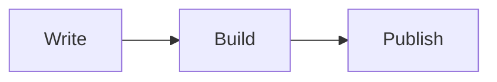

# Article enhancements

`article` sets global defaults for content enhancements. An entry overrides them with same-named frontmatter fields.

```ts
article: {
  math: true,
  mermaid: true,
  lightbox: true,
  callouts: true,
  toc: { enabled: true, minDepth: 2, maxDepth: 4, expandDelay: 1000 },
  shareCover: {
    enabled: true, width: 1200, height: 630,
    background: '#f5f5f5', foreground: '#171717', accent: '#3b82f6',
  },
}
```

## KaTeX math

Write inline math as `$E=mc^2$` and surround display math with two `$$` lines:

```md
$$
\int_0^1 x^2\,dx = \frac{1}{3}
$$
```

KaTeX renders formulas at build time. `math: false` retains TeX source.

## Mermaid diagrams

Use a code block marked `mermaid`:

````md

````

The renderer loads as the diagram approaches the viewport, with colors following appearance changes. Readers can expand the source. `mermaid: false` displays a code block.

## PhotoSwipe image lightbox

Click body images to enlarge them, with zoom, image switching and keyboard support. Lightbox resources load on the first opening. Linked images use their links; exclude an individual image with `data-no-lightbox`.

## Callouts

```md
> [!NOTE]
> A helpful note.

> [!WARNING] Custom title
> Check images and links before publishing.
```

Supported markers are NOTE, TIP, IMPORTANT, WARNING, CAUTION, INFO, SUCCESS, QUESTION and DANGER. Callouts support Markdown and nested quotations.

## MDX interactive components

### One-off components within an article

Keep one-off components in the same bundle as the article, together with their scripts, styles and component copy. The demo article uses this structure:

```text
content/posts/demos/article-enhancements/
  index.zh.mdx
  index.en.mdx
  SineWave.astro
  sine-wave.ts
  gallery-a.webp
  gallery-b.webp
```

Import the component from an MDX file in the same directory:

```mdx
import SineWave from './SineWave.astro';

<SineWave lang="en" />
```

The component supports amplitude, period and initial-phase sliders, arrow keys and reset. Omitting `lang` uses the site’s default language. The example includes Chinese and English copy, with English for other languages. Add component translations to `labels` in `SineWave.astro`.

Simple one-off markup can also be written directly in MDX:

```mdx
<aside class="not-prose">
  <strong>Experiment notes</strong>
  <p>Drag the sliders above to observe changes to the curve.</p>
</aside>
```

For Astro `<script>`, `<style>` or more complex interactions, keep the source in an `.astro` file inside the bundle and import it from MDX. Component sources in a bundle are published with the article, like other attachments.

### Components shared by multiple articles

Put reusable components in `custom/components/`. For example, create `custom/components/InfoBox.astro`:

```astro
---
interface Props {
  title: string;
}
const { title } = Astro.props;
---

<aside class="info-box not-prose">
  <strong>{title}</strong>
  <slot />
</aside>

<style>
  .info-box {
    padding: 1rem;
    border: 1px solid var(--border);
    border-radius: 12px;
  }
</style>
```

Use it in `content/posts/example/index.mdx`:

```mdx
import InfoBox from '../../../custom/components/InfoBox.astro';

<InfoBox title="Further reading">
  <p>Add supplementary notes here.</p>
</InfoBox>
```

Imports are relative to the current MDX file. Pass copy such as titles from the article, or keep a component-specific language dictionary in `custom/components/`. Astro compiles imported components along with their scripts and styles.

### Client-side interaction

Native Astro components provide interaction through their own `<script>`, without additional framework integrations. For custom elements, bind interaction in `connectedCallback` and clean up listeners in `disconnectedCallback` so the component works after client navigation. The sine-wave example demonstrates this approach.

For React, Vue or Svelte, add the corresponding Astro integration and use directives such as `client:load` or `client:visible` on framework components. This advanced usage requires changes to project dependencies and Astro configuration.

## Satori share covers

`article.shareCover` configures dimensions, colors and fonts. The build outputs PNGs for Open Graph / Twitter metadata. Fonts default to local Noto Sans SC; use `fontPath` for a font file covering your content’s characters.

Generated images are cached and regenerated when content or styles change. Article images use `/[lang]/og/[slug].png`; standalone pages use `/[lang]/page-og/[slug].png`, following the language prefix policy.

Disabling generation uses the ordinary cover for sharing previews. See [Reading, sharing and statistics](./reading.md#sharing-templates) for sharing actions and platforms.

## Per-entry overrides

```yaml
math: true
mermaid: false
lightbox: true
callouts: true
toc: true
shareCover: false
```

`true` enables a feature, `false` disables it, and omission inherits the global value. All four content types support math, diagrams, callouts and lightboxes; articles and standalone pages also support outlines and automatic share covers.
