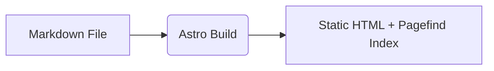

# Article Enhancements

BlogGPT comes with built-in support for mathematical formulas, diagrams, image zoom, callout boxes, and dynamically generated social share covers. All of these are enabled by default in `blog.config.ts` under `article`, and any individual post can override them in its frontmatter.

## KaTeX Math Formulas (`article.math`)

When `article.math: true` (default), you can write inline math with `$...$` and block equations with `$$...$$`:

```markdown
Inline mass-energy equivalence: $E = mc^2$.

$$
\int_{-\infty}^{\infty} e^{-x^2} dx = \sqrt{\pi}
$$
```

To disable math parsing on a specific post (for example, a post about shell scripting or pricing that uses literal `$` characters), set `math: false` in that post's frontmatter.

## Mermaid Diagrams (`article.mermaid`)

When `article.mermaid: true` (default), fenced ` ```mermaid ` code blocks are rendered into interactive SVG diagrams that adapt to light and dark themes:

````markdown

````

## Image Lightbox (`article.lightbox`)

When `article.lightbox: true` (default), readers can click any image inside an article to inspect it in a full-screen zoomable overlay. Set `lightbox: false` in frontmatter if a page contains image links that shouldn't trigger a lightbox.

## Callout Blocks (`article.callouts`)

When `article.callouts: true` (default), GitHub-style blockquote alerts are rendered as styled callout boxes:

```markdown
> [!NOTE]
> Useful context that readers should keep in mind.

> [!TIP]
> A helpful shortcut or best practice.

> [!WARNING]
> Pay close attention before running this command in production.
```

Supported alert types include `NOTE`, `TIP`, `IMPORTANT`, `WARNING`, and `CAUTION`.

## Dynamic Open Graph Share Covers (`article.shareCover`)

Even when a post does not define a manual `image` in frontmatter, BlogGPT can automatically generate a clean `1200×630` PNG social preview card (`og:image`) at build time containing the post title, author, and brand colors:

```ts
export default {
  article: {
    shareCover: {
      enabled: true,
      width: 1200,
      height: 630,
      background: '#f5f5f5',
      foreground: '#171717',
      accent: '#3b82f6',
      // fontPath: './custom/fonts/NotoSansSC-Bold.otf', // Optional custom CJK/Latin font
    },
  },
};
```
